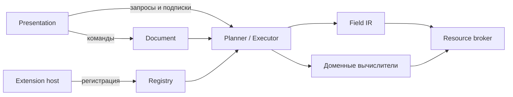

# OPUS_ARCHITECTURE_REVIEW — независимая архитектурная рецензия

- Автор: Claude Opus 5.5, независимый архитектор и рецензент. Дата: 2026-11-21 (Europe/Moscow).
- Предмет: PR #1, head 0cc3eb8, ветка `research/gpt-architecture-2026-11-21`. В первую очередь `docs/research/gpt/ARCHITECTURE_PROPOSAL.md`, а также TECHNOLOGY_COMPARISON, OPEN_QUESTIONS, RISK_REGISTER, EXPERIMENT_PLAN, DEVELOPMENT_ROADMAP и OPUS_REVIEW_BRIEF.
- Точка отсчёта: снимок `00_PRE_GPT_POSITION.md` (позиции T1–T15), закоммиченный до чтения PR #1 (9f2dd32). Источники: `OPUS_SOURCES.md` (O01–O24, проверены 2026-11-21) и реестр GPT `SOURCES.md` (S01–S21).
- Статус: рецензия, а не решение. Стек не утверждается. Ничего не собиралось и не запускалось. Все оценки производительности — арифметика или экспертные оценки, а не измерения.
- Готовые разделы: 0–2.
- Документ пишется по разделам, каждый раздел — отдельным коммитом. Внизу файла стоит маркер конца; если его нет, файл усечён.
- Детали вынесены в OPUS_COMPUTE_CORE.md, OPUS_DATA_MODEL.md, OPUS_NODE_GRAPH.md, OPUS_TECHNOLOGY_RESEARCH.md, OPUS_RISK_ANALYSIS.md, OPUS_ROADMAP_REVIEW.md и OPUS_FINAL_REPORT.md (план — в PROGRESS.md). Здесь — сводные архитектурные выводы.

## 0. Метод и легенда

- Порядок работы: снимок T1–T15 → чтение 19 файлов PR #1 → сверка → находки. Где GPT убедил меня изменить позицию, это сказано явно в разделе 6.
- Маркеры: **[Ф]** — факт с источником; **[О]** — оценка рецензента; **[П]** — предположение; **[?]** — открытый вопрос.
- Серьёзность:
  - **К** — критическая: может потребовать перепроектировать контракт ядра;
  - **В** — высокая: позже переделка обойдётся дорого;
  - **С** — средняя;
  - **Н** — низкая: оформление документов.
- Формат находки соответствует OPUS_REVIEW_BRIEF: утверждение GPT → вывод → основание → серьёзность → предложение → эксперимент → условие пересмотра.

## 1. Резюме

### 1.1. Общая оценка [О]

Предложение GPT — добросовестная и в целом верная рамка:
- модульный монолит;
- типизированные домены и явные конверсии;
- DAG, вычисляемый по требованию;
- отказ от универсального объекта;
- честные границы доказательств.

Почти все пункты контрольного списка моего снимка (T15) оно проходит (раздел 6). Главные слабости — не в общей схеме, а в трёх недоопределённых контрактах, от которых зависят производительность и Visual First:
1. семантика Field: ленивая функция или растр;
2. модель Mesh: треугольники или полигоны;
3. вертикальный срез, который не нагружает самые рискованные контракты ядра.

Кроме того, есть одна стратегическая развилка — состав варианта C.

### 1.2. Согласия

| ID | Решение GPT | Почему согласен |
|---|---|---|
| A1 | Нет единого графа данных и god-object: отдельные типы, семантические дескрипторы, явные конверсии | Совпадает с T1, соответствует R15. Универсальный тип размывает инварианты: маска проходит sRGB-преобразование, сцена сводится к мешу |
| A2 | Ядро исполнения не знает доменной семантики; алгоритмы принадлежат доменам | Совпадает с T1. Домены добавляются без правки планировщика |
| A3 | DAG по требованию; циклы — только в ограниченных итерационных конструкциях | Совпадает с T3 и T8. Прецедент — зоны Repeat и Simulation в Blender (O24) |
| A4 | Детерминизм: seed-подпотоки по стабильному ID ноды, допуски для GPU, версия алгоритма | Точнее моего T3: явный отказ от побитового равенства CPU и GPU |
| A5 | Provenance-ключ кэша без хэширования GPU-текстур; кэш в памяти с бюджетом в MVP | Уточняет мой T3 (раздел 6) |
| A6 | Отмена, публикация только последней ревизии, статус blocked-by-upstream | Необходимое условие живых превью (R02) |
| A7 | Подпись — не безопасность; Wasmtime с fuel/epoch и оговоркой про ResourceLimiter; Python — не песочница | Совпадает с T10 и T11 |
| A8 | Формат проекта не выбирается; DTO отделены от runtime-объектов | Соответствует R30 и разделу 15 мастер-промпта |
| A9 | Вариант A проверяется первым, B — только по результатам измерений | Совпадает с T12 |

### 1.3. Главные разногласия и пробелы

| ID | Находка | Серьёзность |
|---|---|---|
| D1 | Field2D не определён как ленивая функция: формулировка «либо rasterized field» смешивает два типа. Field3D нет, хотя пример мастер-промпта Cube → Subdivision → Noise Displacement требует поля в 3D | К |
| D2 | Нет промежуточного представления (IR) для точечных Field-операций. Каждую ноду придётся писать дважды (CPU и WGSL), а последующее слияние ядер потребует переписывания | В |
| D3 | Mesh v1 описан противоречиво: OPEN_QUESTIONS — indexed triangles, PROPOSAL — indexed faces с атрибутами углов. Треугольная модель плохо совместима с subdivision Catmull–Clark (R07) | В |
| D4 | Вертикальный срез почти целиком точечный: в нём нет нелокальной операции (halo/ROI), глобальной редукции, итеративного состояния и смены топологии | В |
| D5 | Не задан контракт единиц для параметров image-операций. Параметры в пикселях (например, радиус) ломают миниатюры и LOD | В |
| D6 | Вариант C (Tauri + React + Rust) добавляет второй стек, IPC и второй GPU-контекст в GPU-центричный продукт. Дешевле вариант C как подмножество A | В |
| D7 | Вектор 2D отложен до G6 вопреки R06 и равному статусу 2D/3D; типа Vector2D нет даже в контракте | С |
| D8 | Gray–Scott — сильный кандидат для органики R05 и единственный ранний stateful-контракт — отложен до G4 | С |
| D9 | В EvalContext нет времени/кадра, хотя оно нужно симуляциям и будущей анимации (R14). Добавить позже — значит изменить все ключи кэша | С |
| E1–E6 | Ошибки и неточности документов (раздел 9) | Н |

### 1.4. Что проверять первым

1. Spike «Field IR»: 8–10 точечных операций → CPU-интерпретатор и генерация WGSL; сравнение с ручными ядрами (D1, D2).
2. Добавить в P1/P2 нелокальную операцию, глобальную редукцию, Gray–Scott и смену топологии (D4, D8).
3. Spike Mesh: куб → Catmull–Clark → displacement на полигональной и треугольной моделях (D3).
4. Провести P4 до любого решения о варианте C (D6).

Ранжированный план проверок — в OPUS_ROADMAP_REVIEW.md и OPUS_FINAL_REPORT.md.

## 2. Независимая архитектура (позиция Opus)

Раздел развивает снимок T1–T14. Что изменилось после чтения GPT — в разделе 6.

### 2.1. Слои системы [О]

| Слой | Отвечает за | Не делает |
|---|---|---|
| Document | Сущности проекта трёх видов: нодовые графы, стеки слоёв, сцены. Стабильные ID, команды, undo/redo | Не хранит результаты вычислений и GPU-объекты |
| Registry | Типы, ноды, конвертеры, версии определений. Встроенные ноды регистрируются тем же API, что и плагины | Не исполняет |
| Planner / Executor | Запрос → подграф → план; кэш, бюджеты, отмена, приоритеты, диагностика | Не знает семантики доменов |
| Field IR | Типизированное выражение для точечных операций: CPU-интерпретатор пакетами и генерация WGSL | Не компилирует весь граф |
| Доменные вычислители | Image, Geometry, Vector2D, Material, Scene, Composition, Simulation | Не планируют вычисления других доменов |
| Resource broker | Хэндлы, резидентность CPU/GPU, учёт памяти, поколение устройства | Не обещает zero-copy везде |
| Presentation | Оболочка, канвас нод, инспекторы, 2D/3D-вьюеры, миниатюры | Не вычисляет на UI-потоке |
| Extension host | Wasm-песочница, доверенный native-режим, права | Не даёт плагину прямой доступ к документу |
| Persistence / Export | DTO, миграции, профили экспорта | Формат проекта не выбирает (раздел 15 мастер-промпта) |

Состав слоёв совпадает с GPT, кроме двух отличий: явный слой Field IR и явный домен Vector2D.

### 2.2. Два класса операций — центральное решение [О]

**Точечные операции.** Значение в точке зависит только от входов в той же точке или в точках, вычисляемых аналитически.
- Примеры: шумы, Voronoi, domain warp как композиция координат, симметрия как отображение координат, color ramp, арифметика масок.
- Представление: Field<T> — ленивая чистая функция координат.
- Свойства: цепочка сливается в одно ядро и вычисляется в любом разрешении без накопления ошибок ресэмплинга.

**Материализующие операции.** Результат зависит от окрестности, всего буфера или истории.
- Примеры: blur, distance transform, нормализация по min/max, морфология, reaction-diffusion, эрозия, клеточные автоматы, булевы операции, subdivision.
- Представление: буфер с явным разрешением, extent и граничными условиями — Image, HeightField, Mesh, SimulationState.

**Мосты между классами** — только явные операции:
- Rasterize: Field → Image;
- Sample: Field → атрибут геометрии;
- Bind: Field → вход материала (компиляция в шейдер);
- Lift: Image → Field через фильтруемую выборку.

**Почему это важно:**
1. Domain warp на ленивом поле — точная композиция f(x + g(x)). На растре это ресэмплинг с фильтрацией и halo, и каждая следующая операция warp или symmetry добавляет размытие.
2. Миниатюра 128 px и экспорт 8K — одна и та же функция при разной дискретизации. Visual First получает честные превью (R02).
3. Одно и то же поле применяется к 2D-растру, к вершинам меша и в шейдере материала. Это и есть междоменный клей R15 без универсального типа.

**Прецеденты [Ф]:**
- поля Blender — функции, вычисляемые многократно на разных входах (O24);
- Material Maker собирает шейдер из цепочки нод и допускает пользовательские ноды на GLSL (O20);
- Copernicus держит промежуточные данные на GPU между нодами (O22);
- Substance 3D Designer — Pixel Processor и FX-Map (O23).

### 2.3. Координатные домены поля [О]

Field параметризуется доменом:
- Field2D — плоскость или UV;
- Field3D — пространство объекта или мира;
- позднее — время как дополнительная координата для анимации и аудио (R14).

В срезе достаточно 2D, но тип и правила вывода закладываются сразу. Иначе Noise Displacement по кубу без UV не выразить, а триплановым и объёмным материалам понадобится вторая система.

### 2.4. Модель выполнения [О]

1. Запрос: выход + контекст (extent, разрешение/LOD, seed, качество, время, поколение запроса).
2. Планирование: подграф → слияние цепочек точечных операций во «фрагменты Field IR» → задачи материализации.
3. Исполнение на CPU/GPU → публикация только последней ревизии.

- Ключи кэша — provenance, как у GPT. Early cutoff — только для выходов с дешёвым хэшем содержимого: скаляры, параметры, малые меши.
- Слияние — свойство плана, а не ноды. Граница фрагмента: материализующая нода, отображаемый выход, закреплённая миниатюра или ветвление, где выгоднее сохранить буфер.
- Каждая нода объявляет класс локальности (раздел 3, D4). По нему планировщик решает, что сливать, как резать на тайлы и как строить превью.

### 2.5. Расширяемость [О]

Три уровня по сути совпадают с GPT. Отличие — в уровне Scripting для поэлементных вычислений:
- Пользовательский код для пикселей и точек пишется на маленьком типизированном языке выражений, который компилируется в тот же Field IR.
- Он безопасен по построению: нет I/O, циклы ограничены.
- Он быстр: идёт в WGSL вместе с соседними нодами.
- Ноды и текст становятся двумя представлениями одного IR (T9).
- Wasm — для нелокальных и процедурных алгоритмов (L-системы, разбор форматов). Native — доверенный режим.

### 2.6. Минимальный вертикальный срез Opus [О]

Основная цепочка: Voronoi → Warp → Symmetry (Field) → Rasterize → Blur (нелокальная, halo) → Normalize (глобальная редукция) → HeightField → Displace на полигональном меше после Catmull–Clark (смена топологии) → PBR → viewport → экспорт PNG16/EXR и glTF.

Вторая ветка: Gray–Scott (stateful, ограниченное число шагов) → маска → слой композиции. Плюс одна векторная фигура → Rasterize → маска слоя.

Отличия от среза GPT — в разделе 3 (D4, D7, D8).

<!-- EOF OPUS_ARCHITECTURE_REVIEW (разделы 0–2) -->
