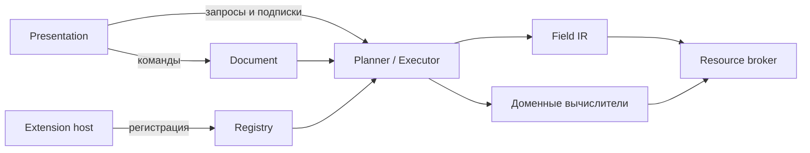

# OPUS_ARCHITECTURE_REVIEW — независимая архитектурная рецензия

- Автор: Claude Opus 5.5, независимый архитектор и рецензент. Дата: 2026-11-21 (Europe/Moscow).
- Предмет: PR #1, head 0cc3eb8, ветка `research/gpt-architecture-2026-11-21`. В первую очередь `docs/research/gpt/ARCHITECTURE_PROPOSAL.md`, а также TECHNOLOGY_COMPARISON, OPEN_QUESTIONS, RISK_REGISTER, EXPERIMENT_PLAN, DEVELOPMENT_ROADMAP и OPUS_REVIEW_BRIEF.
- Точка отсчёта: снимок `00_PRE_GPT_POSITION.md` (позиции T1–T15), закоммиченный до чтения PR #1 (9f2dd32). Источники: `OPUS_SOURCES.md` (O01–O43, проверены 2026-11-21) и реестр GPT `SOURCES.md` (S01–S21).
- Статус: рецензия, а не решение. Стек не утверждается. Ничего не собиралось и не запускалось. Все оценки производительности — арифметика или экспертные оценки, а не измерения.
- Готовые разделы: 0–2; 3 (D1–D6). D7 — IN PROGRESS (сессия 9, записан CP1).
- Документ пишется по разделам, каждый раздел — отдельным коммитом. Внизу файла стоит маркер конца; если его нет, файл усечён.
- Детали вынесены в OPUS_COMPUTE_CORE.md, OPUS_DATA_MODEL.md, OPUS_NODE_GRAPH.md, OPUS_TECHNOLOGY_RESEARCH.md, OPUS_RISK_ANALYSIS.md, OPUS_ROADMAP_REVIEW.md и OPUS_FINAL_REPORT.md (план — в PROGRESS.md). Здесь — сводные архитектурные выводы.

## 0. Метод и легенда

- Порядок работы: снимок T1–T15 → чтение 19 файлов PR #1 → сверка → находки. Где GPT убедил меня изменить позицию, это сказано явно в разделе 6.
- Маркеры: **[Ф]** — факт с источником; **[О]** — оценка рецензента; **[П]** — предположение; **[?]** — открытый вопрос.
- Серьёзность:
  - **К** — критическая: может потребовать перепроектировать контракт ядра;
  - **В** — высокая: позже переделка обойдётся дорого;
  - **С** — средняя;
  - **Н** — низкая: оформление документов.
- Формат находки соответствует OPUS_REVIEW_BRIEF: утверждение GPT → вывод → основание → серьёзность → предложение → эксперимент → условие пересмотра.

## 1. Резюме

### 1.1. Общая оценка [О]

Предложение GPT — добросовестная и в целом верная рамка:
- модульный монолит;
- типизированные домены и явные конверсии;
- DAG, вычисляемый по требованию;
- отказ от универсального объекта;
- честные границы доказательств.

Почти все пункты контрольного списка моего снимка (T15) оно проходит (раздел 6). Главные слабости — не в общей схеме, а в трёх недоопределённых контрактах, от которых зависят производительность и Visual First:
1. семантика Field: ленивая функция или растр;
2. модель Mesh: треугольники или полигоны;
3. вертикальный срез, который не нагружает самые рискованные контракты ядра.

Кроме того, есть одна стратегическая развилка — состав варианта C.

### 1.2. Согласия

| ID | Решение GPT | Почему согласен |
|---|---|---|
| A1 | Нет единого графа данных и god-object: отдельные типы, семантические дескрипторы, явные конверсии | Совпадает с T1, соответствует R15. Универсальный тип размывает инварианты: маска проходит sRGB-преобразование, сцена сводится к мешу |
| A2 | Ядро исполнения не знает доменной семантики; алгоритмы принадлежат доменам | Совпадает с T1. Домены добавляются без правки планировщика |
| A3 | DAG по требованию; циклы — только в ограниченных итерационных конструкциях | Совпадает с T3 и T8. Прецедент — зоны Repeat и Simulation в Blender (O24) |
| A4 | Детерминизм: seed-подпотоки по стабильному ID ноды, допуски для GPU, версия алгоритма | Точнее моего T3: явный отказ от побитового равенства CPU и GPU |
| A5 | Provenance-ключ кэша без хэширования GPU-текстур; кэш в памяти с бюджетом в MVP | Уточняет мой T3 (раздел 6) |
| A6 | Отмена, публикация только последней ревизии, статус blocked-by-upstream | Необходимое условие живых превью (R02) |
| A7 | Подпись — не безопасность; Wasmtime с fuel/epoch и оговоркой про ResourceLimiter; Python — не песочница | Совпадает с T10 и T11 |
| A8 | Формат проекта не выбирается; DTO отделены от runtime-объектов | Соответствует R30 и разделу 15 мастер-промпта |
| A9 | Вариант A проверяется первым, B — только по результатам измерений | Совпадает с T12 |

### 1.3. Главные разногласия и пробелы

| ID | Находка | Серьёзность |
|---|---|---|
| D1 | Field2D не определён как ленивая функция: формулировка «либо rasterized field» смешивает два типа. Field3D нет, хотя пример мастер-промпта Cube → Subdivision → Noise Displacement требует поля в 3D | К |
| D2 | Нет промежуточного представления (IR) для точечных Field-операций. Каждую ноду придётся писать дважды (CPU и WGSL), а последующее слияние ядер потребует переписывания | В |
| D3 | Mesh v1 описан противоречиво: OPEN_QUESTIONS — indexed triangles, PROPOSAL — indexed faces с атрибутами углов. Треугольная модель плохо совместима с subdivision Catmull–Clark (R07) | В |
| D4 | Вертикальный срез почти целиком точечный: в нём нет нелокальной операции (halo/ROI), глобальной редукции, итеративного состояния и смены топологии | В |
| D5 | Не задан контракт единиц для параметров image-операций. Параметры в пикселях (например, радиус) ломают миниатюры и LOD | В |
| D6 | Вариант C (Tauri + React + Rust) добавляет второй стек, IPC и второй GPU-контекст в GPU-центричный продукт. Дешевле вариант C как подмножество A | В |
| D7 | Вектор 2D отложен до G6 вопреки R06 и равному статусу 2D/3D; типа Vector2D нет даже в контракте | С |
| D8 | Gray–Scott — сильный кандидат для органики R05 и единственный ранний stateful-контракт — отложен до G4 | С |
| D9 | В EvalContext нет времени/кадра, хотя оно нужно симуляциям и будущей анимации (R14). Добавить позже — значит изменить все ключи кэша | С |
| E1–E6 | Ошибки и неточности документов (раздел 9) | Н |

### 1.4. Что проверять первым

1. Spike «Field IR»: 8–10 точечных операций → CPU-интерпретатор и генерация WGSL; сравнение с ручными ядрами (D1, D2).
2. Добавить в P1/P2 нелокальную операцию, глобальную редукцию, Gray–Scott и смену топологии (D4, D8).
3. Spike Mesh: куб → Catmull–Clark → displacement на полигональной и треугольной моделях (D3).
4. Провести P4 до любого решения о варианте C (D6).

Ранжированный план проверок — в OPUS_ROADMAP_REVIEW.md и OPUS_FINAL_REPORT.md.

## 2. Независимая архитектура (позиция Opus)

Раздел развивает снимок T1–T14. Что изменилось после чтения GPT — в разделе 6.

### 2.1. Слои системы [О]

| Слой | Отвечает за | Не делает |
|---|---|---|
| Document | Сущности проекта трёх видов: нодовые графы, стеки слоёв, сцены. Стабильные ID, команды, undo/redo | Не хранит результаты вычислений и GPU-объекты |
| Registry | Типы, ноды, конвертеры, версии определений. Встроенные ноды регистрируются тем же API, что и плагины | Не исполняет |
| Planner / Executor | Запрос → подграф → план; кэш, бюджеты, отмена, приоритеты, диагностика | Не знает семантики доменов |
| Field IR | Типизированное выражение для точечных операций: CPU-интерпретатор пакетами и генерация WGSL | Не компилирует весь граф |
| Доменные вычислители | Image, Geometry, Vector2D, Material, Scene, Composition, Simulation | Не планируют вычисления других доменов |
| Resource broker | Хэндлы, резидентность CPU/GPU, учёт памяти, поколение устройства | Не обещает zero-copy везде |
| Presentation | Оболочка, канвас нод, инспекторы, 2D/3D-вьюеры, миниатюры | Не вычисляет на UI-потоке |
| Extension host | Wasm-песочница, доверенный native-режим, права | Не даёт плагину прямой доступ к документу |
| Persistence / Export | DTO, миграции, профили экспорта | Формат проекта не выбирает (раздел 15 мастер-промпта) |

Состав слоёв совпадает с GPT, кроме двух отличий: явный слой Field IR и явный домен Vector2D.

### 2.2. Два класса операций — центральное решение [О]

**Точечные операции.** Значение в точке зависит только от входов в той же точке или в точках, вычисляемых аналитически.
- Примеры: шумы, Voronoi, domain warp как композиция координат, симметрия как отображение координат, color ramp, арифметика масок.
- Представление: Field<T> — ленивая чистая функция координат.
- Свойства: цепочка сливается в одно ядро и вычисляется в любом разрешении без накопления ошибок ресэмплинга.

**Материализующие операции.** Результат зависит от окрестности, всего буфера или истории.
- Примеры: blur, distance transform, нормализация по min/max, морфология, reaction-diffusion, эрозия, клеточные автоматы, булевы операции, subdivision.
- Представление: буфер с явным разрешением, extent и граничными условиями — Image, HeightField, Mesh, SimulationState.

**Мосты между классами** — только явные операции:
- Rasterize: Field → Image;
- Sample: Field → атрибут геометрии;
- Bind: Field → вход материала (компиляция в шейдер);
- Lift: Image → Field через фильтруемую выборку.

**Почему это важно:**
1. Domain warp на ленивом поле — точная композиция f(x + g(x)). На растре это ресэмплинг с фильтрацией и halo, и каждая следующая операция warp или symmetry добавляет размытие.
2. Миниатюра 128 px и экспорт 8K — одна и та же функция при разной дискретизации. Visual First получает честные превью (R02).
3. Одно и то же поле применяется к 2D-растру, к вершинам меша и в шейдере материала. Это и есть междоменный клей R15 без универсального типа.

**Прецеденты [Ф]:**
- поля Blender — функции, вычисляемые многократно на разных входах (O24);
- Material Maker собирает шейдер из цепочки нод и допускает пользовательские ноды на GLSL (O20);
- Copernicus держит промежуточные данные на GPU между нодами (O22);
- Substance 3D Designer — Pixel Processor и FX-Map (O23).

### 2.3. Координатные домены поля [О]

Field параметризуется доменом:
- Field2D — плоскость или UV;
- Field3D — пространство объекта или мира;
- позднее — время как дополнительная координата для анимации и аудио (R14).

В срезе достаточно 2D, но тип и правила вывода закладываются сразу. Иначе Noise Displacement по кубу без UV не выразить, а триплановым и объёмным материалам понадобится вторая система.

### 2.4. Модель выполнения [О]

1. Запрос: выход + контекст (extent, разрешение/LOD, seed, качество, время, поколение запроса).
2. Планирование: подграф → слияние цепочек точечных операций во «фрагменты Field IR» → задачи материализации.
3. Исполнение на CPU/GPU → публикация только последней ревизии.

- Ключи кэша — provenance, как у GPT. Early cutoff — только для выходов с дешёвым хэшем содержимого: скаляры, параметры, малые меши.
- Слияние — свойство плана, а не ноды. Граница фрагмента: материализующая нода, отображаемый выход, закреплённая миниатюра или ветвление, где выгоднее сохранить буфер.
- Каждая нода объявляет класс локальности (раздел 3, D4). По нему планировщик решает, что сливать, как резать на тайлы и как строить превью.

### 2.5. Расширяемость [О]

Три уровня по сути совпадают с GPT. Отличие — в уровне Scripting для поэлементных вычислений:
- Пользовательский код для пикселей и точек пишется на маленьком типизированном языке выражений, который компилируется в тот же Field IR.
- Он безопасен по построению: нет I/O, циклы ограничены.
- Он быстр: идёт в WGSL вместе с соседними нодами.
- Ноды и текст становятся двумя представлениями одного IR (T9).
- Wasm — для нелокальных и процедурных алгоритмов (L-системы, разбор форматов). Native — доверенный режим.

### 2.6. Минимальный вертикальный срез Opus [О]

Основная цепочка: Voronoi → Warp → Symmetry (Field) → Rasterize → Blur (нелокальная, halo) → Normalize (глобальная редукция) → HeightField → Displace на полигональном меше после Catmull–Clark (смена топологии) → PBR → viewport → экспорт PNG16/EXR и glTF.

Вторая ветка: Gray–Scott (stateful, ограниченное число шагов) → маска → слой композиции. Плюс одна векторная фигура → Rasterize → маска слоя.

Отличия от среза GPT — в разделе 3 (D4, D7, D8).

## 3. Рецензия ARCHITECTURE_PROPOSAL: находки D1–D9

Каждая находка: утверждение GPT → вывод → основание → серьёзность → предложение → эксперимент → условие пересмотра. Цитаты GPT взяты из файлов ветки `research/gpt-architecture-2026-11-21` на 0cc3eb8 [Ф].

### D1. Семантика Field: ленивая функция, а не «либо растр» — К

- **Утверждение GPT** [Ф: ARCHITECTURE_PROPOSAL §3.1, §3.3]: Field2D — «Размерность/координаты и способ sample либо явно rasterized field»; «Непрерывное поле не готовая текстура; разрешение выбирается при materialize». Конверсия Field2D → Rasterize задаёт extent, resolution, sampling/filtering, boundary и quality.
- **Вывод** [О]: направление верное — поле не текстура. Но тип допускает две реализации под одним именем: функцию и растр. От выбора зависят точность warp и symmetry, ROI и halo, слияние ядер, честность миниатюр, применимость поля в 3D и в материале. Это должно быть контрактом ядра, а не деталью реализации.
- **Основание:**
  1. [О] Domain warp на растре — это ресэмплинг. Halo пропорционален амплитуде warp и суммируется по цепочке, а каждый шаг добавляет фильтрационное размытие. На функции warp — точная композиция координат.
  2. [Ф] Поля в Blender — функции, вычисляемые многократно на разных входных данных (O24).
  3. [Ф] Пример мастер-промпта (раздел 6) — Cube → Subdivision → Noise Displacement → Material — требует вычислить поле в точках меша, у которых нет UV. Только Field2D этого не выражает; срез GPT обходит вопрос через HeightField + Grid.
- **Предложение:**
  - Field<T, D> — ленивое чистое выражение в Field IR (D2) над доменом D ∈ {2D, 3D};
  - любая нелокальная операция принимает Image или HeightField, а не Field;
  - мосты Rasterize, Sample, Bind и Lift — единственный способ сменить класс данных (раздел 2.2).
- **Эксперимент:** в P2 реализовать Voronoi → Warp → Warp → Symmetry двумя способами: ленивое поле и растр после каждого шага. Разрешения 512² и 2048². Сравнить ошибку относительно эталона 8192², время и пиковую память.
- **Условие пересмотра:** растр по умолчанию допустим, если растровый путь при равной ошибке дешевле и проще на целевых сценариях, а поля в 3D решаются через UV или трипланарную проекцию без потерь для пользователя. Тогда Field остаётся оптимизацией, а не контрактом.

### D2. Field IR: промежуточное представление нужно с G1, слияние — потом — В

- **Утверждение GPT** [Ф: §4.1, §4.3]: ядро «не обязано… компилировать весь граф в shader»; «Disk cache и shader fusion — позже, только после измерений». В TECHNOLOGY_COMPARISON (вариант A) язык шейдеров — WGSL.
- **Вывод** [О]: согласен, что весь граф компилировать не нужно и что слияние можно включить после измерений. Не согласен откладывать само представление.
  - Без IR каждая точечная нода пишется вручную дважды — на Rust для CPU-эталона и на WGSL — и требует теста эквивалентности. При N нодах это 2N реализаций и N сравнений с допусками.
  - Слияние поверх уже написанных ядер потребует переписать их в IR, то есть заплатить дважды.
- **Основание:**
  - [Ф] Генерация одного шейдера из цепочки нод — работающая практика: Material Maker (O20); Pixel Processor в Substance 3D Designer (O23).
  - [О] В EXPERIMENT_PLAN CPU-эталон — оракул («CPU single-thread reference — oracle»). Если эталон и GPU-ядро порождаются из одного IR, расхождения сводятся к различиям float-арифметики, а не к двум независимым реализациям.
  - Гипотезы H2 и H3 (PROGRESS.md) не доказаны — это предмет эксперимента.
- **Предложение (минимум для G1):**
  - типы: f32, i32, u32, bool, vec2–vec4;
  - операции: арифметика, сравнения, select, стандартные функции, выборка из изображения (Lift), RNG как хэш от seed-подпотока и индекса или координаты;
  - циклы только с константной границей;
  - бэкенды: CPU-интерпретатор пакетами по тайлу (SoA) и генератор WGSL;
  - слияние — флаг планировщика, по умолчанию выключен до измерений.
- **Эксперимент — spike «Field IR»:** 8–10 операций: value/gradient noise, Voronoi F1/F2, warp, симметрии rotate/mirror, ramp, арифметика масок. Измерить расхождение CPU/GPU, время добавления новой операции (IR против ручной пары ядер), скорость на 2048² в режимах «слито» и «по нодам».
- **Условие пересмотра:** если для первых 20 операций IR дороже ручных пар ядер и не даёт выигрыша ни в скорости, ни в эквивалентности — оставить ручные ядра и вернуться к IR при росте каталога.

### D3. Mesh v1: полигоны с атрибутами углов, а не треугольники — В

- **Утверждение GPT** [Ф]:
  - OPEN_QUESTIONS: «Первая mesh — indexed triangles + typed attributes»;
  - ARCHITECTURE_PROPOSAL §3.1: «Positions, indexed faces, typed point/corner/face attributes, topology version» и «Render triangles и editable polygon topology различаются»;
  - TECHNOLOGY_COMPARISON (A): «arrays + indexed triangles + attributes; general topology и subdivision позже через адаптер».
- **Вывод:** документы противоречат друг другу [Ф]. По существу права формулировка PROPOSAL [О]:
  - первая модель — полигональная: смещения граней, массив угловых вершин, атрибуты по доменам point / corner / face, позже edge;
  - триангуляция — производное представление для рендера и для библиотек, которым нужны треугольники (Manifold, O18).
- **Основание:**
  - [Ф] Схема Catmull–Clark определена для сеток с произвольными полигонами, схема Loop — только для треугольных. Источники: E. Catmull, J. Clark, «Recursively generated B-spline surfaces on arbitrary topological meshes», Computer-Aided Design, 1978; C. Loop, «Smooth Subdivision Surfaces Based on Triangles», 1987. Классические публикации; web-поиском в этой сессии не перепроверялись.
  - [О] Catmull–Clark формально применим к треугольникам, но поверхность триангулированного куба заметно хуже, чем у квадового. Пользователь DCC ожидает результат на квадах (R07: subdivision, работа с вершинами, рёбрами и полигонами).
  - [Ф] Атрибутные домены point / vertex / primitive / detail — модель Houdini (снимок, T6).
  - [О] Если начать с треугольников, позже придётся мигрировать все геометрические ноды, атрибуты углов и DTO сохранения. Это дороже, чем сразу хранить смещения граней — один дополнительный массив.
- **Предложение:** Mesh v1 = позиции + face_offsets + corner_verts + атрибуты по доменам + topology_version; кэш триангуляции как производные данные. Half-edge или BMesh — не в v1, а только для будущего интерактивного редактирования.
- **Эксперимент — spike Mesh:** куб → Catmull–Clark ×2 → displacement → нормали → glTF на обеих моделях. Сравнить объём кода, корректность UV-швов (атрибуты углов), время и качество поверхности.
- **Условие пересмотра:** если владелец подтвердит, что до G4 нужны только displaced grids без subdivision, треугольники допустимы временно. Но DTO и контракт атрибутов должны быть полигональными с самого начала.

### D4. Вертикальный срез не нагружает нелокальные, глобальные, stateful и топологические контракты — В

- **Утверждение GPT** [Ф]:
  - ARCHITECTURE_PROPOSAL §10: срез — «Seeded Voronoi → Warp → Symmetry → ScalarRange → HeightField → DisplaceGrid; параллельно scalar/color ramp → material base color» и 2D layer composition с mask.
  - EXPERIMENT_PLAN, P2: workload «seeded Voronoi/warp/symmetry/range», «displacement grid 257×257, затем 513×513»; UX-цель сформулирована «для этой короткой stateless цепочки».
  - ARCHITECTURE_PROPOSAL §4: EvalContext несёт «ROI/LOD/resolution»; ключ кэша включает «extent/region, resolution/LOD»; «Для tile/ROI фильтров нужны halo regions; global normalisation и distance transforms не pretend-local».
  - §4.6 и §9: «Сначала bounded Gray–Scott/клеточный автомат как кандидат», в алгоритмах Gray–Scott идёт «следом»; DEVELOPMENT_ROADMAP, G4: «bounded RD/fractal candidate» и «primitive/subdivision/displacement по доказанной модели».
  - §4: ядро «не обязано… реализовывать subdivision».
- **Вывод** [О]:
  - GPT верно назвал все четыре рисковых класса: halo, нелокальную нормализацию, stateful-переход и различие render/editable topology. Но ни один из них не входит в P1/P2 и G1–G2.
  - Ноды среза поточечные (Voronoi, Symmetry, ramp, арифметика) или работают на сетке с фиксированной топологией (DisplaceGrid). Два уточнения:
    - [?] Если ScalarRange сам находит min/max входа, это глобальная редукция, и срез частично её покрывает. В документах GPT это не определено, и ни один fixture P1/P2 это не проверяет.
    - [О] Warp над полем (D1) поточечный: поле вычисляется в смещённой точке. Warp над растром — выборка по данным с окрестностью до максимальной амплитуды. В срезе GPT Warp стоит до растеризации, поэтому этот класс не проверяется.
  - Последствие: G2 закрепит ARCHITECTURE.md и ADR, проверив EvalContext, ключ кэша, Resource Broker и планировщик только на поточечных операциях над целым буфером. Первая нода другого класса появится в G4, уже после ADR. Если контракт региона окажется неверным, переделывать придётся ядро и все ноды. Поэтому серьёзность В, а не С.
- **Механизм по классам** [О, если не указано иное]:
  1. **Окрестность** (blur, нормали из высоты, эрозия, выделение границ).
     - Для выходного региона R нужен входной регион R, расширенный на радиус ядра r. Цепочке из k таких нод нужен halo k·r.
     - Граница домена и граница тайла — разные вещи. Clamp, wrap и mirror задаются на границе домена; на границе тайла нужны настоящие соседние данные. Для tileable-текстур (§9 GPT) halo переходит через периодическую границу.
     - [Ф] OpenFX: хост спрашивает эффект, «given a region I want to render, what region do you need from each of your input clips» (O25). Footprint объявляет нода, регион вычисляет хост.
     - [Ф] Halide: конвейеры обработки изображений — это «large graphs of different stencil stages, as well as complex reductions, and stages with global or data-dependent access patterns» (O26).
  2. **Глобальная редукция** (автонормализация, auto levels, выравнивание гистограммы, точное преобразование расстояний).
     - Каждый выходной пиксель зависит от всего входа, поэтому запрос любого региона превращается в запрос всего домена.
     - Главная ловушка — LOD. Min/max превью 512² и экспорта 4096² вычисляются по разным выборкам, и нормализованная миниатюра может молча отличаться от экспорта. Политику нужно объявить: статистика считается на опорном разрешении либо превью помечается как приближённое (связь с D5).
     - [Ф] На GPU редукция внутри блока идёт деревом; чтобы обменяться частичными результатами между блоками, нужна глобальная синхронизация (Harris, O27). [О] Отсюда минимум два прохода. Скаляр может остаться на GPU как буфер, и тогда цель P2 «без readback между GPU-этапами» сохраняется. Readback нужен только тогда, когда значение требуется CPU или UI.
     - [О] Min/max не зависят от порядка операций, поэтому CPU и GPU должны совпасть точно. Сумма и среднее зависят: для proof удобны min/max, а сумма проверяет допуски.
  3. **Состояние** (Gray–Scott).
     - S(t+Δt) = F(S(t)), и каждый шаг — стенсил. Halo растёт на r за шаг, поэтому после N шагов вычисление по ROI фактически становится вычислением всего домена.
     - Результат зависит от шага сетки. Миниатюра как «тот же граф на меньшем LOD» (§7 GPT) для RD даёт другой узор. Контракт подробно разбирается в D8, время в ключе кэша — в D9. Здесь только требование, чтобы ядро допускало этот класс.
     - [Ф] Pearson: простая модель реакции–диффузии даёт «a surprising variety of irregular spatio-temporal patterns», и они возникают «in response to finite-amplitude perturbations» (O28). Начальное возмущение и seed — входы модели; GPT это уже указал (§4.6).
  4. **Смена топологии** (Catmull–Clark, смена разрешения сетки).
     - Меняется число элементов. Атрибуты point/corner/face интерполируются по своим правилам (D3). topology_version меняется, кэш ниже по графу инвалидируется, GPU-буферы меняют размер.
     - [Ф] OpenSubdiv «optimized for drawing deforming surfaces with static topology at interactive framerates»; регулярные грани — «quads for Catmull-Clark, tris for Loop» (O29). [О] Быстрый путь библиотеки амортизирует анализ топологии, пока она статична; при смене топологии анализ повторяется.
     - [О] DisplaceGrid 257→513 формально меняет топологию, но регулярная сетка полностью задаётся параметрами и не проверяет атрибуты углов и произвольные полигоны.
- **Прецедент цены** [Ф]: в 2021 году в Blender начали переводить тайловый композитор на full-frame. Причина: «Memory usage can be very high for complex/long trees as buffers are kept from tree execution start to finish». Новая схема: «creating buffers on first read and freeing them as soon as all their readers have finished» (O30). В 4.2 LTS CPU-бэкенд композитора переписан, поведение изменено ради согласованности с GPU и вьюпортом (O31). [О] Модель регионов — дорогой контракт: зрелый проект заплатил за её смену переписыванием. Это довод проверить её в G1, а не в G4. И довод в пользу простой реализации full-frame с ранним освобождением буферов.
- **Альтернативы:**
  - A1. Оставить срез GPT и добавить классы в G4. Дешевле сейчас, но есть риск переделки EvalContext и кэша после ADR.
  - A2. Только full-frame, без ROI в контракте. Проще всего и достаточно, пока буферы до 4096² помещаются в бюджет. Тайлинг для больших экспортов позже станет изменением контракта.
  - A3. Планировщик в стиле Halide с языком расписаний. [О] Слишком тяжело для небольшой команды на G1.
  - **Рекомендация (PROP):** footprint и класс локальности объявляются в контракте ноды с G1, реализация остаётся full-frame. Объявления проверяются тестом эквивалентности кропа. Тайлинг потом включается без смены контракта.
- **Предложение (PROP): два уровня**

| Класс | Нода | Что проверяет | (1) Proof: G1/P1, CPU | P2, GPU | (2) Продуктовый срез, G3 |
|---|---|---|---|---|---|
| Окрестность | Blur (сепарабельный, радиус в единицах домена) или HeightField→NormalMap 3×3 | footprint, halo, граница домена | обязательно | обязательно (2 прохода) | Blur и NormalMap |
| Глобальная редукция | Normalize (min/max) | класс global, статистика как отдельный handle, политика LOD | обязательно | обязательно, скаляр остаётся на GPU | гистограмма и levels — по решению владельца |
| Состояние | GrayScott 128², до 500 шагов, явная схема | state handle, шаг в ключе, checkpoint, reset | минимально: только контрактные тесты | отложить | ветка RD (D8) |
| Топология | DisplaceGrid со сменой разрешения; Catmull–Clark ×1–2 на полигональной Mesh (D3) | topology_version, смена размера буферов, атрибуты углов | смена разрешения — обязательно; Catmull–Clark — в spike Mesh (D3) | отложить | Catmull–Clark → Displace → PBR → экспорт |

  - (1) Минимальный proof: к цепочке GPT добавляются Blur, Normalize, минимальный CPU-шаг RD и смена разрешения сетки. Новых доменов нет. Цель — проверить контракты, а не дать функции продукта.
  - (2) Продуктовый срез соответствует §2.6 этой рецензии. [О] Он шире и может оказаться избыточным для первого MVP; объём утверждает владелец. Proof от этого решения не зависит.
- **Измеримые критерии** (ничего не запускалось):
  - Успех:
    1. Halo: на 100+ случайных ROI, включая углы и периодическую границу, результат по ROI совпадает с кропом full-frame. На CPU — побайтно, на GPU — в объявленном допуске.
    2. Цепочка из k Blur: входной регион R⊕k·r вычисляет ядро по объявленным footprint, а не код ноды. Проверяется по журналу запрошенных регионов.
    3. Normalize: запрос любого тайла даёт один запрос всего домена; статистика считается один раз на ревизию входа (счётчик = 1 при N запросах тайлов); min/max на CPU и GPU совпадают точно; превью 512² совпадает с уменьшенным экспортом 2048² в допуске либо помечено как приближённое.
    4. RD: два прогона с одним seed побайтно равны на CPU. Продолжение из checkpoint K плюс N−K шагов равно прямому прогону N шагов. Изменение upstream сбрасывает состояние с видимой диагностикой. Отмена посреди прогона не публикует частичное состояние как итог. Запрос шага M никогда не возвращает состояние шага N≠M.
    5. Топология: смена разрешения увеличивает topology_version и инвалидирует кэш mesh ниже по графу, а правка только материала mesh не пересчитывает. После 100 переключений VRAM и RSS возвращаются к базовому уровню в пределах допуска; устаревших вершинных буферов нет.
    6. Стоимость контракта: после первой ноды каждого класса следующие ноды того же класса добавляются без изменения кода планировщика — только объявлениями.
  - Провал: любое расхождение в п. 1–5; особые случаи в исполнителе для каждого нового класса (п. 6); readback между Blur, Normalize и HeightField на GPU-пути без объявленной причины.
- **Эксперимент — расширение spike P1/P2 («P1+»):**
  - CPU: 1024²; Blur с r = 8 единиц домена; виртуальные тайлы 256² только для проверки footprint; Normalize; RD 128² × 500 шагов с checkpoint каждые 100 шагов; смена разрешения сетки 257↔513.
  - Журнал: запрошенные регионы, счётчики вызовов, байты, пики RSS.
  - GPU: сепарабельный Blur и многопроходная редукция; считать readback и fences.
  - [?] Допускает ли целевой путь шейдеров атомарный min/max для f32 — не удалось подтвердить в этой сессии. Proof строится на многопроходной редукции и от ответа не зависит.
- **Связь с другими находками:** D1 — halo появляется после Rasterize, поточечные операции над полем его не требуют. D2 — IR в G1 только для поточечных операций; стенсилы и редукции пишутся вручную. D3 — модель Mesh. D5 — единицы радиуса и LOD статистики. D8 — контракт RD. D9 — время в ключе кэша.
- **Условие пересмотра:**
  - Если владелец подтвердит, что до G4 в продукте нет RD и subdivision, а ADR на G2 явно отметит EvalContext и ключ кэша как пересматриваемые, пункты «Состояние» и Catmull–Clark переносятся.
  - Окрестность и глобальная редукция остаются в любом случае: нормали из высоты (для GPU-смещения и normal map) и автодиапазон нужны уже для смещения и миниатюр.
  - Если P1 покажет, что full-frame укладывается в бюджеты памяти на 4096² для целевых цепочек, footprint остаётся в контракте, а тайлинг не реализуется.

### D5. Единицы параметров image-операций: смысл превью, миниатюры и LOD не определён — В

- **Утверждение GPT** [Ф] (ARCHITECTURE_PROPOSAL, blob 8762b2e на 0cc3eb8; EXPERIMENT_PLAN, blob 88e3c9f):
  - §3.4: «SI-метаданные, radians для углов, явно объявленная handedness/up axis и UV origin». О единицах параметров растровых операций (радиус, смещение, размер ячейки, ширина обводки) не сказано ничего.
  - §4.1 и §4.3: EvalContext несёт «ROI/LOD/resolution»; ключ кэша включает «extent/region, resolution/LOD» и «quality mode».
  - §5: «Миниатюра — подписка на evaluator с более низким LOD, не PNG-обманка. При zoom-out сокращаются частота и детализация; preview не обещает export resolution».
  - P2: приёмка требует «explicit image origin/UV/unit/color fixtures», а thumbnails логируются «отдельно». Что проверяет unit fixture, не определено.
  - Исправление ссылки [Н]: мастер-промпт и D4 относят формулировку о миниатюре к §7. В ARCHITECTURE_PROPOSAL на 0cc3eb8 она стоит в §5, а §7 посвящён Scripting, Native и пакетам. Текст D4 не меняю, исправление фиксирую здесь. Решения владельца не требуется.
- **Вывод** [О]:
  - GPT прав: миниатюра должна быть настоящим вычислением на меньшем LOD. Но пока у параметров нет единиц, фраза «тот же граф на меньшем LOD» не определена. Если радиус Blur задан в пикселях, миниатюра 512² для экспорта 4096² размыта относительно кадра в 8 раз сильнее. Пользователь видит не тот результат, который получит.
  - Затронуто не только размытие. Те же вопросы у амплитуды warp после растеризации, размера ячейки, dilate/erode маски, ширины обводки, радиуса нормалей из высоты и halo из D4.
  - Единицы есть и у выходных значений: расстояние в distance transform, наклон в нормалях из высоты, смещение. Если они в пикселях, значения меняются вместе с разрешением.
  - Пример [О, арифметика]: высота h задана в единицах домена. Если градиент считается разностью соседних пикселей без деления на шаг сетки, то при переходе 512² → 2048² наклон уменьшается в 4 раза, и normal map становится плоской. На одном разрешении ошибку не видно.
  - Последствие: значения параметров записываются в проекты. Смена единиц после появления пользовательских файлов потребует миграции и изменит вид старых проектов. Вместе с footprint из D4 это контракт ядра, поэтому серьёзность В.
- **Независимость** [О]: проблема обозначена в D4 (радиус Blur в единицах домена, политика LOD для статистики) и следует из раздела 2.3. Снимок T1–T15 в этой сессии не перечитывался, поэтому не утверждаю, что D5 был в исходной позиции.
- **Прецеденты** [Ф]:
  - OpenFX (O32). Три системы координат: Canonical («square unscaled pixels»), Pixel (с pixel aspect ratio и render scale) и Normalised. Пространственные параметры хранятся в canonical; «Scaling to Pixel Coordinate is the responsibility of the effect». Тип параметра различает размер и позицию (kOfxParamDoubleTypeX, XY, XYAbsolute). Нормализованные параметры «proved to be somewhat more of a problem than expected» и объявлены устаревшими начиная с API 1.2. Хост может пометить рендер как миниатюру (kOfxImageEffectPropThumbnailRender, необязательное свойство).
  - After Effects SDK (O33): «a blur of 4 pixels should be interpreted as a blur of 2 pixels if the downsample factor is 1/2»; «any slider which defines a size in pixels will be a problem when the image is rendered downsampled». Пересчёт скалярных параметров — обязанность эффекта.
  - Nuke (O34): в proxy mode «All images and all x/y positions are scaled by this factor. This produces the same (or at least very similar) composite at a different scale». [?] Как пересчитываются скалярные размеры, например радиус размытия, в выдержке не сказано.
  - Houdini Copernicus (O35): у Blur параметр Units со значениями Image (по умолчанию), Pixels и Local. Image space «Maps from -1 through 1 across the display window, which scales the image to fit to preserve the pixel aspect ratio»; превью ноды показывает выход в окне −1…1. В старой сети COP2 вариант UV Coords описан как «resolution independent».
  - Blender (O36): в руководстве 4.0 у Blur есть опция Relative: «Percentage Value of the blur radius relative to the image size». В Python API 4.5 use_relative помечен «(Deprecated: Unused.)», в руководстве 5.2 LTS опции нет. [?] Единицы Size в 5.x и причину отказа подтвердить не удалось.
  - Substance 3D Designer (O37): разрешение ноды наследуется (Absolute, Relative to input, Relative to parent), и граф пересчитывается под выбранный размер. Предупреждение «Non-Relative to parent x1 output size parameter» означает, что граф не сможет выдавать текстуры произвольного разрешения. [?] Единицы Intensity у Blur HQ подтвердить не удалось.
  - [О] Продукты с превью на пониженном разрешении приходят к одному решению. Параметр хранится в независимых от разрешения единицах, а в пиксели его переводит хост (Nuke, Copernicus) или плагин по масштабу, полученному от хоста (OpenFX, AE). Нормализация к размеру кадра в OpenFX не прижилась.
- **Предел точности на малом LOD** [Ф]: по Линдебергу (O38), если σ непрерывного гауссиана больше 0,75–1 пикселя, дискретизированное ядро даёт «very good approximations». На меньших масштабах дисперсия дискретного ядра заметно меньше. [О] Узкое размытие с σ < 1 px на сетке миниатюры расходится с уменьшенным экспортом. Это расхождение нужно либо включить в допуск, либо уменьшить дискретным аналогом гауссиана.
- **Альтернативы** [О]:

| Модель | Предсказуемость и UX | Смена разрешения, preview/LOD | UI и реализация | Кэш и воспроизводимость | 2D-домены |
|---|---|---|---|---|---|
| 1. Пиксели | точна на одном разрешении; привычна ретушёрам | вид меняется молча; превью неверно без пересчёта | проще всего | resolution уже в ключе; повтор только на том же разрешении | у Image и HeightField разный смысл одного числа |
| 2. Нормализованные 0…1 по осям | не зависит от разрешения; малые числа вроде 0,002 неудобны | устойчиво | просто | без проблем | анизотропия на неквадратном кадре; в OpenFX устарело |
| 3. Доля размера кадра, % | понятно «% кадра», но надо определить, какой стороны | устойчиво, пока не меняется аспект | просто | без проблем | нужна общая договорённость о «размере»; в Blender опция устарела |
| 4. Пространство выбирается у каждого параметра (Copernicus) | точно, если пространство видно | зависит от выбора | меню у каждого параметра; средняя сложность | единица входит в ключ | пространства надо согласовать между доменами |
| 5. Вид величины объявлен в контракте ноды | высокая | устойчиво; исключения помечены | одно поле и подсказка в пикселях; перевод в ядре | канонические значения плюс LOD | общие единицы домена |

- **Рекомендация (PROP): модель 5, по умолчанию — единицы домена**
  1. Схема параметра объявляет вид величины: Length, Position, Frequency (циклов на единицу домена), Angle (радианы, как в §3.4 GPT), Pixels (явная привязка к сетке), Dimensionless.
  2. Канонические единицы — единицы домена Field2D (D1, раздел 2.3). У домена есть протяжённость в этих единицах. Для HeightField и terrain единицей может быть метр (SI по §3.4 GPT). Для генераторов кандидат — пространство вроде Image space в Copernicus: аспект сохраняется, кадр вписан в окно. [?] Точную нормировку определяет ADR.
  3. Ядро передаёт в EvalContext масштаб «пикселей на единицу домена» по каждой оси. Нода не выводит смысл параметра из размера буфера. Перевод Length в пиксели и footprint из D4 (halo_px = ceil(k·r·ppu)) делает ядро, а не код ноды.
  4. Выходные величины длины (расстояние, наклон, смещение) тоже в единицах домена. Нормаль из высоты делит разность на шаг сетки.
  5. Вид Pixels разрешён: dilate маски на 1 px, сглаживание края, импортированный растр 1:1. Но такая нода зависит от разрешения, и её выход со всем, что ниже по графу, помечается на превью как приближённый.
  6. Контракт превью: для независимых от разрешения цепочек превью на LOD k совпадает с уменьшенным финальным результатом в объявленном допуске. Исключения (Pixels, малые σ, глобальная статистика из D4, RD из D8) помечаются, а не скрываются. Это уточняет фразу GPT «preview не обещает export resolution»: превью не обещает детализацию экспорта, но обязано сохранять его смысл.
  7. UI: одно числовое поле в единицах домена и подсказка «≈ N px при текущем разрешении». Единицы отображения — настройка пользователя, а не меню у каждого параметра.
  8. Ключ кэша: канонические значения плюс resolution/LOD, как у GPT (§4.3). Смена LOD не инвалидирует результат полного разрешения. Смена разрешения документа не меняет сохранённые значения параметров.
  - Уточнение к D4: в P1+ «Blur r = 8 единиц домена» при 1024² означает домен протяжённостью 1024 единицы, то есть 8 px при 1024² и 2 px при 256².
- **Компромиссы** [О]:
  - Модель 5 добавляет в ядро перевод единиц, а в каждую схему параметра — вид величины.
  - Ретушёрам, привыкшим к пикселям (Photoshop, AE), нужна подсказка в пикселях.
  - Для импортированного растра нужна политика протяжённости домена: от пикселя или от кадра.
  - Модели 1–3 проще, но их ошибки видны только при смене разрешения или на миниатюре, то есть поздно.
- **Измеримые критерии** (ничего не запускалось):
  - Успех:
    1. LOD. Цепочка Voronoi → Rasterize → Blur (Length) → Normalize → HeightField → NormalMap. Превью 256², 512² и 1024² сравниваются с уменьшенным экспортом 4096². Ошибка не выходит за заранее объявленный допуск. Начальное предложение: RMSE ≤ 0,01 нормированного диапазона, отклонение нормалей ≤ 2°. Исключение — пиксели в пределах halo у границы домена при clamp.
    2. Смена разрешения документа 1024² → 2048² не меняет ни одного сохранённого значения параметра. Уменьшенный результат совпадает с прежним в том же допуске.
    3. Нормали при 512² и 2048² дают одинаковый средний наклон в пределах допуска. Контрольный «пиксельный» вариант должен разойтись примерно в 4 раза, иначе тест нечувствителен.
    4. Пометка «приближённо»: в fixture с нодой вида Pixels помечено 100 % затронутых превью и 0 % незатронутых.
    5. Тест эквивалентности кропа из D4 проходит на трёх LOD; footprint в пикселях вычисляет ядро из Length.
    6. Для σ < 1 px на сетке превью отклонение от уменьшенного экспорта измерено для дискретизированного гауссиана и для дискретного аналога. Выбранный вариант записан вместе с допуском.
    7. Переключение LOD туда и обратно не пересчитывает полное разрешение: счётчик вызовов kernel равен 0.
  - Провал: параметр вида Length меняет относительный вид результата при смене разрешения; нода сама читает разрешение для перевода единиц; превью с нодой Pixels не помечено.
- **Эксперимент**: fixture «D5» в составе P1+/P2. Это только план, запуск — с разрешения владельца.
  - CPU-референс. Разрешения 256², 512², 1024² и 4096²; неквадратный кадр 2048×1024 для проверки аспекта. Экспорт уменьшается box-фильтром, ядро объявляется заранее.
  - На одной цепочке сравниваются модели 1 и 5. Модели 2–4 оцениваются аналитически: от модели 5 они отличаются способом хранения, а не исполнением.
  - Метрики: RMSE и максимальная ошибка, угол нормалей, число вызовов kernel, журнал запрошенных регионов.
  - Ограничения: допуски предварительные; понятность модели 5 для пользователя проверяется только в P3; GPU-путь этот fixture не проверяет.
- **Связь с другими находками:** D1 и раздел 2.3 — домен Field2D задаёт единицы. D4 — footprint в единицах домена и политика LOD для статистики. D7 — смещения и направления в Vector2D тоже Length и Position, а не цвет. D8 — шаг сетки RD и единицы коэффициентов диффузии. D9 — время как ещё одна единица.
- **Условие пересмотра:**
  - Если владелец решит, что главный 2D-сценарий — ретушь растра фиксированного разрешения, вид Pixels становится умолчанием для импортированных изображений. Модель 5 остаётся для генераторов.
  - Если P3 покажет, что единицы домена путают начинающих, хранение остаётся каноническим, а по умолчанию показываются пиксели.
  - Если допуск критерия 1 окажется недостижим на 256² для типовых цепочек, миниатюры получают постоянную пометку «приближённо» вместо обещания эквивалентности.

### D6. Вариант C Opus — этап A, а не отдельный стек; Tauri/WebView — вопрос владельца, а не только эксперимента — В

- **Термины** [Ф/О]:
  - C GPT (TECHNOLOGY_COMPARISON, blob 8de0c5b на 0cc3eb8): «Tauri 2 shell + TypeScript/React frontend + Rust headless core».
  - C Opus (снимок T12, 9f2dd32, записан до чтения PR #1): «подмножество A без перехода на другой стек» — Rust + wgpu + egui, «без C++ FFI в v1», «Field DSL вместо внешнего скриптового языка», «плагины только WASM».
  - Буквы совпали случайно. Чтобы их больше не путать, дальше C Opus называется **A-min** (PROP: использовать это имя в следующих документах; текст старых разделов не меняется).
- **Утверждение GPT** [Ф] (TECHNOLOGY_COMPARISON 8de0c5b; EXPERIMENT_PLAN 88e3c9f; RISK_REGISTER aba425a; OPUS_REVIEW_BRIEF 150b192, все на 0cc3eb8):
  - C назван «реалистичный для небольшой AI-assisted команды». GPU-ускорение — «только после proof транспортного пути; не обещать native wgpu textures напрямую в OS WebView»; «Native GPU и WebGPU/WebGL — отдельные resource/device domains, нельзя предполагать общий GPU handle».
  - Недостатки C у самого GPT: «два стека/тестовых контура, IPC и копии, cross-platform различия WebView и GPU capabilities»; «При high-res procedural GPU продукте усложнение мостов может съесть первоначальную выгоду».
  - A у GPT: «Scripting сначала visual graphs, затем Wasmtime»; «C ABI/out-of-process для native SDK позднее»; OIIO/OCIO/OpenSubdiv — «через изолированный FFI или converter tool».
  - Рекомендация: «A проверять первым… C запускать как конкурентный transport/UI spike, если web expertise меняет стоимость». P4: «Native GPU texture → WebView sharing не предполагается поддержанным». K03: «CPU↔GPU копии уничтожают интерактивность».
  - Brief: «Можно ли сохранить один GPU-resident pipeline с egui/wgpu? Какова реальная цена webview/native interop в C…?»
- **Поправка к строке D6 в разделе 1.3** [О]: формулировка «вариант C добавляет второй стек, IPC и второй GPU-контекст» верна по сути, но GPT этих издержек не скрывает и C первым не рекомендует. Реальное разногласие уже: (1) ярлык «реалистичный для небольшой команды» у C при GPU-центричном продукте; (2) порядок: GPT ставит P4 как конкурентный spike, а я считаю, что сначала нужно решение владельца о допустимости WebView; (3) «A-min дешевле» — гипотеза H7, а не факт. Строку 1.3 не меняю, поправка — здесь.
- **Расхождение формулировок** [Н]: MASTER_PROMPT v7.0 §21 п. 9 говорит об «отложении WASM plugins». По снимку T12 A-min оставляет WASM единственным путём для плагинов и откладывает native-плагины. Первоисточник — снимок; ниже разобраны оба случая. Решения владельца не требуется.
- **Состав** [О]:

| Подсистема | A (T12) | A-min (C Opus) | Переход A-min → A |
|---|---|---|---|
| Ядро и домены | Rust, headless-библиотека + CLI | то же | нет |
| GPU | wgpu, WGSL/naga | то же | нет |
| UI-оболочка | egui или Slint — по эксперименту | egui | нет, если A выберет egui; иначе замена слоя Presentation (цена зависит от H6) |
| Резервный UI | Qt 6 через C ABI | нет | добавление |
| Field IR + текстовый DSL | да (T9) | да; DSL — единственный язык пользовательского кода | нет |
| Внешний скриптинг | Luau для стороннего кода, Python как доверенная автоматизация (T10) | нет | добавление, если API хоста описан через возможности (capabilities) |
| C++ FFI (OIIO, OCIO, OpenSubdiv, OpenVDB, MaterialX, USD) | да, изолированно | нет в v1 | добавление, если буферы не привязаны к владению Rust |
| Плагины | WASM для стороннего кода + доверенные native | только WASM | native ABI — добавление; семантика должна совпасть с WASM-интерфейсом |
| Сборка и CI | Cargo + C++ toolchain/CMake на трёх ОС | только Cargo | добавляется второй toolchain |

- **Подмножество ли это** [О]:
  - По составу кода и зависимостей — да, если A выберет egui. Если A выберет Slint, A-min — уже не подмножество, а ответвление, и UI придётся менять.
  - По инфраструктуре — да: один язык, один toolchain, один отладчик.
  - По контрактам — не автоматически. Есть четыре места, где решение A-min может закрыть дорогу к A:
    1. Владение памятью. Если результаты в ядре — это Vec<T> с владением Rust, C++-библиотеки потом получат данные только копированием. GPT уже предлагает «immutable handle + descriptor» (ARCHITECTURE_PROPOSAL §2) — это верная основа; нужно явно допустить буфер с внешним аллокатором.
    2. Интерфейс плагинов. Если API хоста для WASM — набор разрозненных функций, native C ABI позже станет вторым API. Нужен один описанный набор возможностей хоста, который отображается и в WASM, и в C ABI.
    3. Скриптинг. Если Field DSL начнут расширять до языка общего назначения (I/O, произвольные циклы), он потеряет безопасность по построению (раздел 2.5) и всё равно не заменит Python для автоматизации.
    4. UI. Если состояние редактора живёт внутри виджетов egui, смена оболочки — это переписывание. H6 требует отдельной модели представления.
  - Вывод: «C ⊂ A» верно для состава. «A-min → A без миграции» верно только при инвариантах из рекомендации ниже. Без них A-min становится отдельным продуктом.
- **Где экономия реальна** [О, оценка, не измерение]:

| Упрощение в A-min | Экономия | Отложенная цена |
|---|---|---|
| Нет C++ FFI | Высокая: один toolchain на трёх ОС, нет bindgen/cxx, нет межъязыковой отладки и сбоев на границе, меньше лицензионного аудита (K11) | Субдивизия, цветовой менеджмент, EXR, булевы операции — свои реализации или крейты Rust; позже — FFI или converter tool |
| Нет Python/Luau | Высокая: нет встраивания интерпретатора, нет публичного API привязок и его версионирования | Профессиональная автоматизация откладывается; часть закрывает CLI headless-ядра |
| Нет native-плагинов | Высокая: нет обязательств по стабильному ABI | Сторонние GPU-ноды с окрестностью невозможны: из WASM нет GPU (T11, O08); точечные GPU-ноды закрывает Field DSL |
| Нет резервного Qt | Средняя: нет второго UI и LGPL-обязательств | Если egui и Slint не пройдут P3, запасного пути нет |
| Field IR | Нет: он нужен и в A | Если убрать его ради экономии, вернётся двойная реализация CPU/WGSL (D2) |
| GPU-путь, упаковка, подпись, драйверная матрица | Нет: та же цена в A | — |
| Продуктовый UI на egui | Нет: тот же риск, что в A (K08, H6) | — |

  - Итог: экономия A-min — в отказе от **второго языка и публичных обязательств** (ABI, API скриптов), а не в ядре или GPU. Самые дорогие части продукта — ядро, Field IR, GPU-путь, нодовый UI — в A и A-min одинаковы. A-min дешевле A, но не на порядок; численную оценку без состава команды дать нельзя [?].
- **C++ FFI** [О]: для первой существенной версии (критерии §10.1 мастер-промпта: запуск, редактор, ядро, превью, базовые 2D и 3D) ни одна C++-библиотека не обязательна. Чувствительные места:
  - Catmull–Clark для среза Opus (2.6): своя реализация для полигональной модели D3 реальна; адаптивная GPU-субдивизия уровня OpenSubdiv — нет.
  - Цвет: без OCIO нужна минимальная, но явно описанная модель (линейный рабочий цвет, sRGB для отображения). Иначе при подключении OCIO старые проекты изменят вид.
  - EXR и булевы операции: зрелость крейтов Rust в этой сессии не проверялась [?].
  - Условие: буферные хэндлы допускают внешний аллокатор (инвариант 2).
- **Field DSL / IR** [О]: A-min без IR не дешевле, а дороже (D2). Сокращать можно текстовый DSL: в v1 достаточно IR и нод, текстовый синтаксис — позже поверх того же IR. Так A-min сохраняет уровень Scripting для точечных вычислений без внешнего языка.
- **Плагины** [О]:
  - Вариант снимка (только WASM): сторонние CPU-алгоритмы возможны с ограничениями fuel/epoch (T11); сторонние GPU-ядра — только через Field DSL. Для v1 этого достаточно.
  - Вариант «отложить все плагины в v1»: допустим, если встроенные ноды регистрируются тем же API (T9). Тогда внешний API появится без переделки реестра.
  - Native ABI и публичный SDK — позже; это совпадает с GPT («C ABI/out-of-process позднее»).
- **Стоимость GPU-ориентированного desktop-продукта** [Ф + О]: она общая для A и A-min и не исчезает в C GPT.
  - Связка версий: egui-wgpu собирается под конкретный wgpu. Сигнатуры CallbackTrait в docs.rs ссылаются на epaint 0.37.0 и wgpu 30.0.0 (O43, O10). Обновлять придётся парой.
  - Общее устройство: eframe отдаёт RenderState с adapter, device, queue и target_format, а свой wgpu-рендер встраивается в окно egui через paint callback (O43). [О] Значит, в A/A-min вычисления ядра и показ могут идти на одном wgpu-устройстве без копирования через CPU. Это главное техническое преимущество перед C GPT. Экспериментально не проверено.
  - Остальное: валидация шейдеров, device lost, матрица драйверов Windows/macOS/Linux, отсутствие f64 в WGSL (O04), тестирование на реальных GPU. Это постоянный бюджет, а не разовая работа.
- **Небольшая команда** [О]: A-min реалистичен для небольшой команды с опытом Rust. Главный риск смещается в продуктовое качество UI на egui: нодовый канвас, docking, кириллица и IME, HiDPI, доступность (K08, H6). Состав и навыки команды — OPEN, это сведения от владельца. Если команда сильна в web и слаба в Rust, оценка меняется (см. условие пересмотра).
- **WebView и Tauri (C GPT)** — техническая пригодность отделена от соответствия требованию:

| Вопрос | Техническая пригодность | Основание |
|---|---|---|
| Настольный исполняемый файл | Да: Tauri собирает нативное приложение с установщиком; на Windows до 11 установщик ставит WebView2 | [Ф] O39 |
| Качество UI | Высокое возможно: web-стек силён в сложных интерфейсах | [О] |
| Движок отображения | Системный и разный: WebView2 (Chromium) на Windows; WKWebView на macOS, WebKitGTK на Linux | [Ф] O39 (Windows), S06 GPT; [?] разделы macOS/Linux страницы O39 в выдержке не видны |
| GPU | Вычисления в Rust/wgpu и показ в WebView — разные устройства, общего хэндла нет (это признаёт и GPT). WebGPU внутри WKWebView и WebKitGTK для встраиваемых приложений не подтверждён | [Ф] P4 GPT; [?] O42 |
| IPC | В Tauri 2 есть сырые бинарные payload и каналы с ArrayBuffer; раньше всё шло через JSON. Обмен — передача сообщений через core-процесс | [Ф] O40, O41 |
| Большие данные | Каждый кадр большого превью или меш пересекает границу процессов минимум с одной копией | [О] |
| Память | Отдельные процессы WebView и дубли изображений на стороне WebView | [О], не измерено |
| Отладка | Два отладчика и граница IPC; три разных движка WebView | [О] |
| Распространение | WebView2 на Windows ставит установщик; на Linux поведение зависит от версии WebKitGTK в дистрибутиве | [Ф] O39; [?] Linux не проверен |
| Восприятие «настоящей программы» | Не технический вопрос | OPEN — владелец |

  - Арифметика [О]: превью 2048² RGBA8 — 16 МиБ на кадр; при перетаскивании параметра с 30 fps это 480 МиБ/с через IPC. 4096² RGBA f16 — 128 МиБ на кадр. Меш на 1 млн вершин (позиция, нормаль, UV) — 32 МБ на обновление. Миниатюры 128² RGBA8 по 64 КиБ × 50 нод ≈ 3,1 МиБ на обновление — терпимо. Узкое место — не миниатюры, а интерактивный вьюер высокого разрешения и 3D.
  - Гибрид «нативное окно wgpu + WebView-оболочка» возможен: multiwebview в Tauri 2.0 вышел за нестабильным флагом (O40). Но это два UI-контура, вопросы фокуса, ввода и наложения окон; GPT сам пишет, что такой переезд меняет риски. [?] Наложение нативной поверхности и WebView в одном окне не проверялось.
  - Вывод: технически Tauri-приложение — настоящий исполняемый файл, и CPU-ядро в нём то же. Для GPU-центричного продукта с живым превью C GPT добавляет транспортный слой, которого нет в A/A-min. Соответствие требованию «настоящая desktop-программа» (REQ; мастер-промпт §8: WebView «не следует автоматически считать подходящими») — решение владельца. WebView не объявляется ни приемлемым, ни неприемлемым.
- **Последствия для MVP** [О]: первая существенная версия достижима в A-min без C++ FFI и внешнего скриптинга. Рискованные места — свой Catmull–Clark, минимальная модель цвета, экспорт EXR, качество UI на egui. Explanation System выбор между A и A-min не затрагивает: она опирается на ядро и превью.
- **Рекомендация (PROP)**:
  1. Считать C Opus не третьим стеком, а этапом A — **A-min**. Это снимает путаницу с C GPT.
  2. Инварианты A-min, без которых переход к A станет переписыванием. Это и есть возможности, которые нельзя потерять при раннем упрощении:
     1. headless-ядро + CLI; UI — сменяемый слой с отдельной моделью представления (T12, H6);
     2. непрозрачные хэндлы данных, допускающие внешний аллокатор и GPU-резидентность; превью без readback через CPU (K03);
     3. Field IR — единственное представление точечных вычислений; DSL и ноды — его фронтенды (D1, D2);
     4. один описанный набор возможностей хоста для плагинов; встроенные ноды регистрируются через него (T9);
     5. контракты D3–D5: полигональный меш с атрибутами углов, класс локальности и footprint, виды величин;
     6. стабильные ID нод и версии определений с первого дня (T8);
     7. кириллица, IME и HiDPI в UI — с первой версии.
  3. Отложенное — с явными триггерами: C++ FFI — при первой реальной потребности в OCIO, адаптивной субдивизии, USD или VDB; Python — при запросе профессиональной автоматизации, которую не закрывает CLI; native-плагины — когда сторонним авторам понадобятся GPU-алгоритмы с окрестностью; резервный UI — если egui и Slint не пройдут P3.
  4. До P4 получить решение владельца о допустимости WebView в принципе. Если WebView не допускается, P4 не нужен, и C GPT снимается с рассмотрения. Если допускается — P4 по критериям ниже, на тех же fixtures, что и A-min. Решение владельца дешевле эксперимента.
  5. Не представлять A-min как «упрощённое ядро»: экономия — в отказе от второго языка и публичных обязательств, а не в Field IR и контрактах D1–D5.
- **Альтернативы** [О]:

| Путь | Плюсы | Минусы |
|---|---|---|
| A целиком сразу | Нет последующих добавлений | Цена второго toolchain и публичных API до подтверждения потребности |
| A-min → A | Один язык; обязательства откладываются | Нужна дисциплина инвариантов; часть алгоритмов пишется самостоятельно |
| C GPT (Tauri) | Быстрая итерация UI при web-команде | Транспорт GPU/IPC, два стека, вопрос соответствия REQ |
| Гибрид: окно wgpu + WebView-оболочка | Нативный вьюер, web-панели | Два UI-контура, ввод и фокус, нестабильный multiwebview |
| B (C++/Qt/Vulkan) | Контроль и экосистема C++ | Самый дорогой старт (согласен с GPT) |

- **Компромиссы** [О]: A-min требует писать часть алгоритмов самостоятельно и откладывает профессиональную автоматизацию. Инварианты добавляют работы в начале (хэндлы с внешним аллокатором, описание возможностей хоста), но обходятся дешевле миграции. Ранний выбор egui сужает A, если эксперимент с UI выберет Slint.
- **Измеримые критерии** (ничего не запускалось):
  - Проверка подмножества (без кода): каждый модуль A, которого нет в A-min, описан как добавление, и публичные типы ядра для него не меняются, кроме нового варианта хэндла. Провал: для подключения FFI или native-плагина приходится менять типы ядра или реестра.
  - Путь превью A-min (spike — только с разрешения владельца): Field IR → WGSL → текстура → paint callback egui на том же устройстве. Успех: 0 readback на кадр вьюера (по счётчику); записаны p95 от изменения параметра до кадра и загрузка CPU в простое; предварительный порог — p95 ≤ 100 мс на 2048². Провал: показ требует копии через CPU.
  - P4 — только если владелец допустил WebView: те же fixtures 512²/2K/4K и меши; байты host→WebView на одно действие, p95 до кадра, суммарный RSS всех процессов, поведение на трёх ОС; сравнение с A-min на той же машине. Предварительный порог провала C GPT: p95 на 2K хуже A-min более чем вдвое или RSS выше более чем в 1,5 раза. Пороги — предложения, а не измерения.
  - Внешний аллокатор: тестовый C-буфер оборачивается хэндлом ядра без копирования (счётчик копий 0), либо копия явно документирована.
- **Эксперимент**: «путь превью A-min» и «внешний буфер» — дополнения к P2; P4 — по решению владельца. Это только план, запуск — с разрешения владельца.
- **Ограничения исследования**: ничего не собиралось и не измерялось; GPU и целевых ОС нет. Состав команды неизвестен. Зрелость крейтов Rust для EXR, булевых операций и субдивизии не проверялась. WebGPU во WKWebView и WebKitGTK не подтверждён: источники O42 противоречивы и частично вторичны. Страницы O39–O43 целиком не загружались, использованы выдержки поиска. Оценки экономии качественные.
- **Связь с другими находками**: D2 — Field IR обязателен и в A-min. D3 — полигональная модель упрощает позднее подключение OpenSubdiv. D4 и D5 — контракты не зависят от стека. D8 — Gray–Scott на GPU проверит общий путь устройства. H6 и H7 — проверяются критериями выше. Э7 — перепроверка S06–S10 и окончательное сравнение стеков.
- **Условие пересмотра**:
  - Владелец допускает WebView, а команда сильна в web и слаба в Rust — C GPT становится реальным конкурентом, решает P4.
  - Подтверждён WebGPU во всех трёх системных WebView и появился путь без копий между нативным ядром и WebView — главный аргумент против C GPT ослабевает.
  - egui и Slint не проходят P3 — A-min теряет UI-основу; рассматриваются Qt через C ABI или гибрид.
  - Владелец требует уже в первой версии цветовой менеджмент уровня OCIO, USD или VDB — C++ FFI переходит в v1, и A-min сводится к A.

### D7. Vector2D и семантика двумерных величин — С — IN PROGRESS

- Статус: IN PROGRESS, сессия 9. Записан CP1: семантика и предварительный вывод. CP2 (пять вариантов, Vector3D, Field2D) и CP3 (рекомендация, вопросы владельцу) ещё не записаны.
- **Утверждение GPT** [Ф] (ARCHITECTURE_PROPOSAL и DEVELOPMENT_ROADMAP на 0cc3eb8):
  - §3.1: семейство «Scalar / Integer / Boolean / Vector / Color», контракт «Числовой формат, единицы, color-space для цвета», обоснование «Вектор не цвет, число не angle без контекста».
  - §3.3: «Field2D → Rasterize: extent, resolution, sampling/filtering, boundary, quality»; «HeightField + Grid → DisplaceMesh: sampling/UVs, edge boundary, normals recompute»; «Image/Field → Material texture binding: UV/space и color semantic явно заданы».
  - §3.4: «явно объявленная handedness/up axis и UV origin».
  - G6: «Terrain, Nature, Architecture, более богатые materials/geometry, векторный pipeline и ограниченные simulations добавляются по одному».
- **Уточнение формулировки D7 из раздела 1.3** [Н]. Там сказано: «Вектор 2D отложен до G6 … типа Vector2D нет даже в контракте». Сверка с текстом GPT:
  1. Тип Vector в контракте есть (§3.1). Не определены его размерность, отличие точки от направления, нормали и UV, а также единицы по видам величин из D5.
  2. [О] «Векторный pipeline» в G6 по контексту означает векторную графику: кривые, пути, SVG (ср. §8 GPT: «SVG для настоящих vectors»). Это не числовой тип Vector2D. Вопросы разные: тип значения нужен с G1, векторная графика — отдельный домен Curve/Path.
  3. [?] Определение R06 в файлах, прочитанных в этой сессии, не найдено. Связь с R06 не перепроверена.
  - Текст раздела 1.3 не меняю: прежние результаты не переписываются. Серьёзность С сохраняю. Проблема не в отсутствии слова Vector, а в отсутствии семантики. Это контракт портов, и он попадает в сохранённые проекты.
- **Размерность домена и размерность значения независимы** [О]:
  - Field2D<Scalar> — высота;
  - Field2D<Displacement2> — поле для warp;
  - Field2D<Normal3> — normal map из высоты: домен 2D, значение 3D;
  - Field3D<Displacement3> — смещение вершин меша.
  - Поэтому вид и размерность значения нельзя выводить из размерности домена, и наоборот.

#### D7.A. Семантические виды и допустимые операции (CP1) [О]

Числовая база у всех видов 2D, кроме Length и Color, одна — два числа с плавающей точкой. Различаются смысл, единицы и поведение при преобразовании координат. Единицы — по видам величин из D5.

| Вид | Смысл | Единицы | Допустимые операции | Запрещено или только явным узлом | При аффинном преобразовании |
|---|---|---|---|---|---|
| Position | точка в объявленном пространстве | Length (единицы домена) | P − P → Displacement; P + Displacement → P; lerp(P₁, P₂, t) и взвешенный центр с суммой весов 1 → P; distance(P, P) → Length | P + P; k·P; длина и нормировка точки | поворот, масштаб и перенос |
| Displacement | разность двух позиций | Length | D ± D → D; k·D → D; длина → Length; normalize → Direction с политикой для нуля; dot(D, Direction) → Length | трактовка D как точки | линейная часть, без переноса |
| Offset | имя параметра в UI для Displacement: сдвиг узора, смещение pivot | Length | как Displacement | отдельный вид не нужен | как Displacement |
| Direction | единичный вектор | безразмерный | Length · Direction → Displacement; dot → косинус; поворот на Angle → Direction; perp → Direction; atan2 → Angle | Direction + Direction как Direction: результат — Displacement, нужен normalize | поворот; после неравномерного масштаба — нормировка |
| Vector без уточнения | — | — | — | на портах не нужен: это Displacement, Direction или Float2; допустим как имя семейства | — |
| Length | скалярное расстояние, вид из D5 | Length | Length · Direction → Displacement; Length / Length → безразмерное | смешение с Angle и безразмерными без явного узла | умножается на коэффициент масштаба; при неравномерном масштабе неоднозначно [?] |
| Size | ширина и высота, ≥ 0 | Length | Size · k (k ≥ 0) → Size; Size ⊙ Scale → Size; Position + Size + anchor → Bounds | P + Size без anchor; отрицательный размер; Size − Size без политики | масштаб; поворот превращает Bounds в описанный прямоугольник — явно |
| Scale | коэффициенты по осям | безразмерный | Scale ⊙ Scale → Scale; Scale ⊙ Displacement или Size → тот же вид; к точке — только с pivot: pivot + s ⊙ (P − pivot) | Scale + Position; нулевой масштаб без диагностики | композиция |
| Normal | перпендикуляр к кривой (2D) или поверхности (3D), единичный | безразмерный | flip; dot с Direction; perp(Tangent) в 2D | сложение как у Displacement; перенос | обратно-транспонированная матрица и нормировка; отражение меняет ориентацию |
| Tangent | направление вдоль кривой или поверхности | безразмерный; производная по параметру — Length на единицу параметра | как Direction | смешение с Normal | линейная часть и нормировка; в 3D добавляется знак handedness |
| UV | координаты в параметризации ресурса или поверхности | безразмерные, с объявленным origin (§3.4 GPT) | UV − UV → смещение в UV; lerp; sample(Image, UV) | UV ↔ Position без явного отображения через bounds или карту; UV + Displacement | не меняется при трансформации объекта |
| Coordinates | запись позиции в конкретной системе координат | зависят от системы | — | не вид, а способ записи: пространство (домен, object, world, pixel, UV) — метаданные | смена пространства — явная конверсия |
| Color | значение в объявленном цветовом пространстве, 3–4 канала | color-space (§3.1 GPT) | смешивание и арифметика в линейном рабочем пространстве (§3.4 GPT) | геометрические операции; неявное приведение к вектору и обратно | не трансформируется |
| Float2 | пара чисел без геометрического смысла: диапазон min/max, пара коэффициентов | безразмерная или объявленная | любые покомпонентные | неявное приведение к Position, Displacement или UV | не трансформируется |

- Прецедент [Ф]: OpenFX различает в типах параметров размер и абсолютную позицию — kOfxParamDoubleTypeXY и XYAbsolute (O32, см. D5).
- Явная перекодировка данных — отдельная операция. Пример: flow map хранит Displacement в каналах RG изображения. Узел Reinterpret объявляет диапазон и вид и не применяет цветовое преобразование.

#### D7.B. Предварительный вывод CP1 [О]

1. Числовая база одна: два (в 3D — три) float-компонента. Семантика нужна на уровне портов, параметров и атрибутов, а не в коде каждого ядра.
2. Минимальный набор видов 2D для раннего контракта: Position, Displacement (Offset — только имя в UI), Direction, Size, Scale, UV, Float2. Normal и Tangent нужны в 3D уже в срезе (displace, normals recompute). В 2D они понадобятся с кривыми.
3. Соединение обязано отклонять: Position + Position; Color ↔ любой вектор; UV ↔ Position без bounds; Float2 → геометрический вид без явного узла. Трансформация обязана различать Position и Displacement: перенос действует только на точку.
4. Можно оставить метаданными без запрета: Offset и Displacement; Tangent и Direction. Direction → Displacement допустимо только через умножение на Length.
5. Предварительно это склоняет к варианту 5 (гибрид). В CP2 нужно проверить вариант 4 (пара с обёртками) и цену для начинающих: слишком много видов на портах ухудшает UX.

<!-- EOF OPUS_ARCHITECTURE_REVIEW (разделы 0–2, 3:D1–D6, D7 IN PROGRESS) -->
